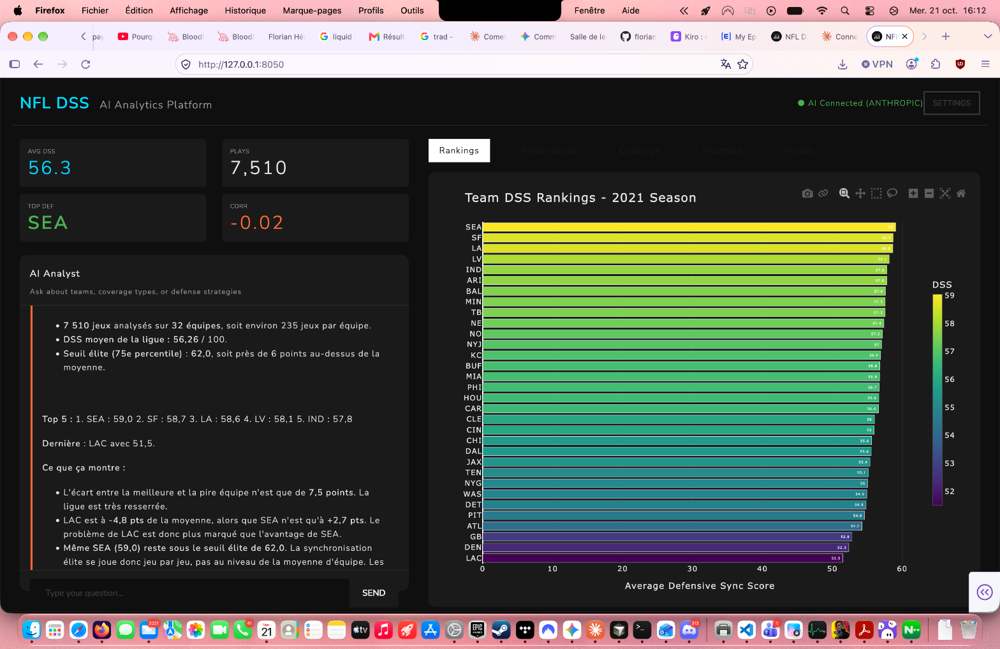
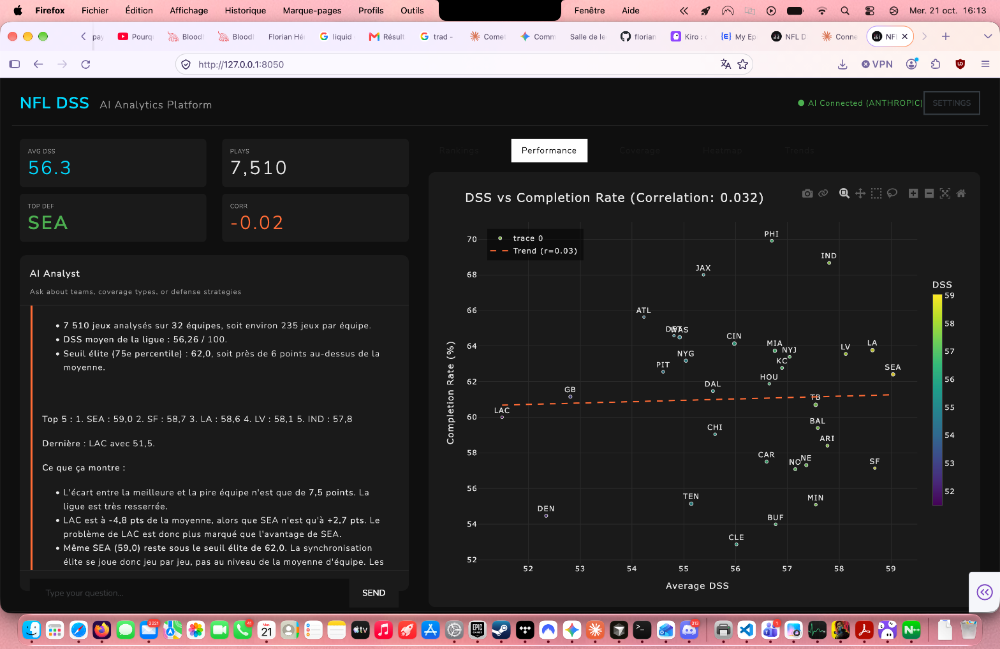
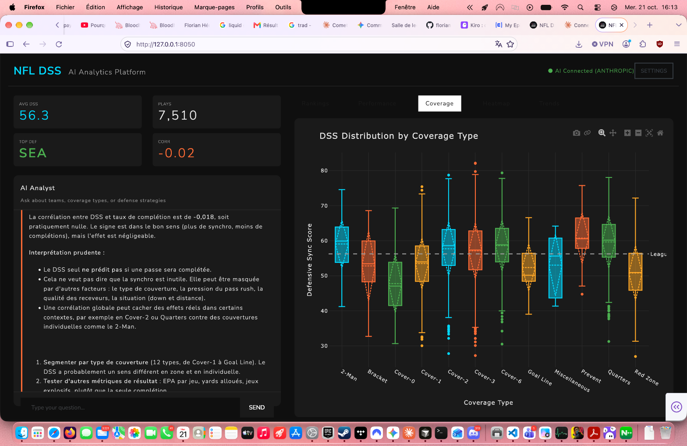
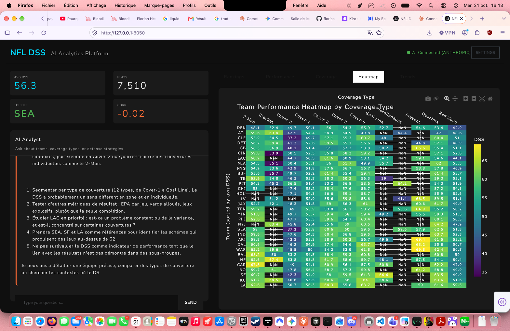
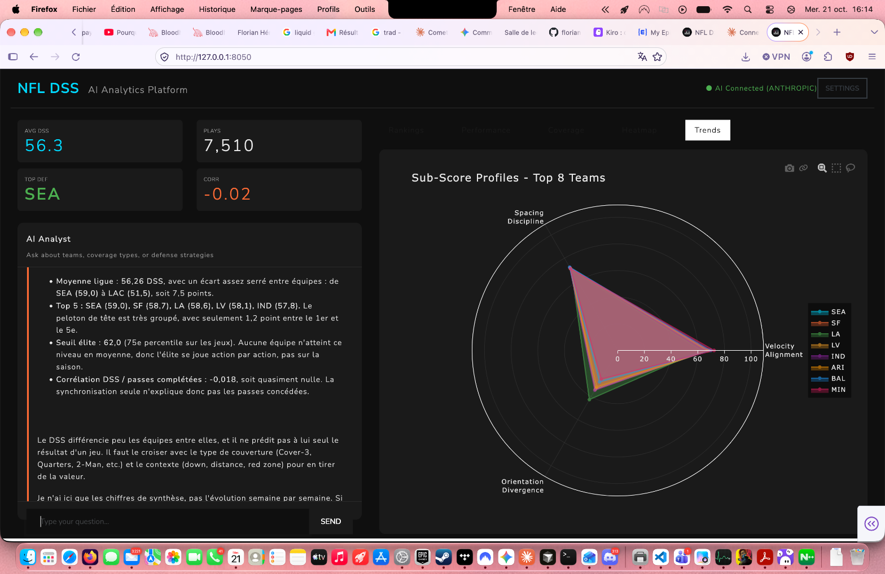

# NFL Defensive Sync Score (DSS) Analytics Platform

> **Next-Generation AI-Powered Analytics for NFL Defense Strategy**

A professional analytics platform analyzing 7,510 NFL plays from the 2021 season, featuring real-time AI insights and interactive visualizations. Designed for coaches, scouts, and analysts who demand clarity over chaos.

[](https://www.python.org/)
[](https://plotly.com/dash/)
[](https://www.anthropic.com/)
[](LICENSE)

---

## Features

### **Professional Analytics Dashboard**
- **Real-time Team Rankings** - Compare all 32 NFL teams by DSS
- **Performance Correlation** - Analyze DSS vs completion rates
- **Coverage Analysis** - Deep dive into 12+ coverage types
- **Interactive Heatmaps** - Team × Coverage performance matrix
- **Sub-Score Radar** - Multi-dimensional defensive profiles

### **AI-Powered Insights**
- **Bring Your Own AI** - Support for OpenAI, Anthropic Claude, Mistral AI, Google Gemini
- **Natural Language Queries** - Ask questions in plain English/French
- **Built-In Analytics Engine** - Works without external APIs
- **Smart Fallback** - Automatic switch to built-in mode on API errors

### **Modern UX**
- **Dark Theme** - Professional interface optimized for long sessions
- **Responsive Layout** - 40/60 split for chat and visualizations
- **Loading Indicators** - Clear feedback on AI processing
- **Zero Emojis** - Clean, professional design

---

## Screenshots

### Team Rankings

*Horizontal bar chart showing DSS rankings for all 32 teams with Viridis color scale*

### Performance Analysis

*Correlation analysis between DSS and completion rates (r=0.032)*

### Coverage Deep Dive

*Distribution analysis across 12+ coverage types with statistical insights*

### Team × Coverage Heatmap

*Detailed performance matrix showing team effectiveness by coverage scheme*

### Sub-Score Profiles

*Multi-dimensional radar chart for top 8 teams (VA, SD, OD dimensions)*

---

## Quick Start

### Prerequisites

```bash
Python 3.9+
pip (Python package manager)
```

### Installation

```bash
# Clone the repository
git clone https://github.com/florianhemery/nfl-pocket-collapse.git
cd nfl-pocket-collapse

# Create virtual environment
python -m venv .venv
source .venv/bin/activate  # On Windows: .venv\Scripts\activate

# Install dependencies
pip install -r requirements.txt

# Run the application
python src/app_nextgen.py
```

### Access

Open your browser and navigate to:
```
http://127.0.0.1:8050
```

---

## AI Configuration

The platform supports multiple AI providers. Click **Settings** in the top-right corner to configure:

### Supported Providers

| Provider | Models | Pricing | Notes |
|----------|--------|---------|-------|
| **Anthropic Claude** | Sonnet 5.5, Opus 5.5, Fable 5.1, Haiku 5.5 | $0.10 - $50 per MTok | Recommended for best results |
| **OpenAI** | GPT-4 Turbo, GPT-4, GPT-3.5 Turbo | Standard OpenAI pricing | Most stable API |
| **Mistral AI** | Large, Small, Open Mixtral, Open Mistral | Free & paid tiers | Good cost/performance |
| **Google Gemini** | Gemini Pro, Gemini Pro Vision | Free tier available | Great for testing |

### Example Queries

```
"Analyze SEA defensive performance"
"Compare coverage effectiveness"
"Which teams excel at Cover-3?"
"Show me the top 5 defenses"
"Explain the DSS metric"
```

---

## Dataset

- **7,510 NFL plays** from the 2021 season
- **32 teams** analyzed
- **12+ coverage types** (Cover-0 to Red Zone)
- **4 core metrics**:
  - **DSS** - Defensive Sync Score (composite metric)
  - **VA** - Velocity Advantage
  - **SD** - Spacing Discipline  
  - **OD** - Orientation Divergence

---

## Technology Stack

- **Backend**: Python 3.9+
- **Web Framework**: Plotly Dash 2.x
- **Visualizations**: Plotly, Plotly Express
- **Data Processing**: Pandas, NumPy
- **AI Integration**: OpenAI, Anthropic, Mistral, Google AI SDKs
- **UI Components**: Dash Bootstrap Components

---

## Project Structure

```
nfl-pocket-collapse/
├── src/
│   ├── app_nextgen.py          # Main NextGen application
│   ├── app.py                  # Legacy Dash app
│   └── app_v2.py               # V2 with filters
├── output/
│   └── dss_results.csv         # Core dataset (7,510 plays)
├── screenshots/                 # UI screenshots for README
├── docs/
│   ├── CLAUDE_2026_MODELS.md   # Claude AI setup guide
│   ├── TROUBLESHOOTING_COMPLETE.md
│   └── NEXTGEN_README.md
├── requirements.txt            # Python dependencies
└── README.md                   # You are here
```

---

## Troubleshooting

### Common Issues

#### "ID not found in layout"
✅ **Fixed in v2.0** - Removed dynamic callback that caused race conditions.

#### API Rate Limit (429)
✅ **Auto-fallback** - Switches to built-in analytics mode automatically.

#### ThinkingBlock AttributeError
✅ **Fixed** - Properly parses Claude 5.x response structure.

### Need Help?

Check our comprehensive guides:
- [TROUBLESHOOTING_COMPLETE.md](TROUBLESHOOTING_COMPLETE.md) - Full diagnostic guide
- [CLAUDE_2026_MODELS.md](CLAUDE_2026_MODELS.md) - Claude AI setup
- [MISTRAL_TROUBLESHOOTING.md](MISTRAL_TROUBLESHOOTING.md) - Mistral AI guide

---

## Roadmap

- [ ] Real-time game tracking
- [ ] Multi-season comparisons
- [ ] Player-level analytics
- [ ] Export to PDF/PowerPoint
- [ ] Mobile-responsive design
- [ ] Custom metric builder
- [ ] Team comparison mode
- [ ] Historical trend analysis

---

## Development History

### v2.0 - NextGen Interface (Oct 2026)
- ✅ Professional UI without emojis
- ✅ AI-powered chat with 4 providers
- ✅ Loading indicators
- ✅ 40/60 layout split
- ✅ Built-in analytics fallback
- ✅ Claude 5.x support
- ✅ ThinkingBlock parsing

### v1.0 - Original Dashboard
- Initial Plotly Dash implementation
- Basic team rankings and filters
- Static visualizations

---

## Contributing

Contributions are welcome! Please feel free to submit a Pull Request.

1. Fork the repository
2. Create your feature branch (`git checkout -b feature/AmazingFeature`)
3. Commit your changes (`git commit -m 'Add some AmazingFeature'`)
4. Push to the branch (`git push origin feature/AmazingFeature`)
5. Open a Pull Request

---

## License

This project is licensed under the MIT License - see the [LICENSE](LICENSE) file for details.

---

## Author

**Florian Hemery**

- GitHub: [@florianhemery](https://github.com/florianhemery)
- Project: [nfl-pocket-collapse](https://github.com/florianhemery/nfl-pocket-collapse)

---

## Acknowledgments

- NFL data from 2021 season analysis
- Plotly for amazing visualization capabilities
- Anthropic, OpenAI, Mistral, Google for AI APIs
- The defensive analytics community

---

## Stats


---

<p align="center">
  <strong>Built for NFL Analytics</strong>
</p>
